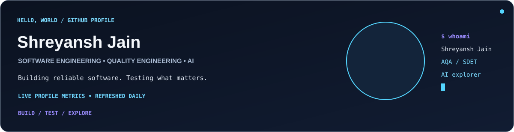
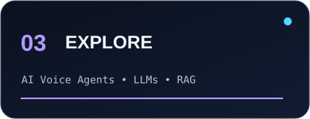
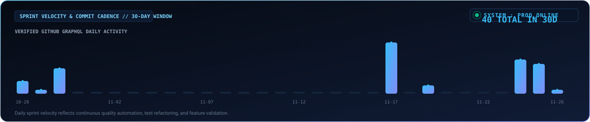
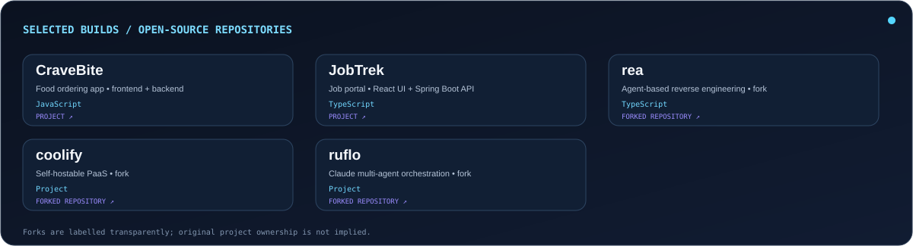
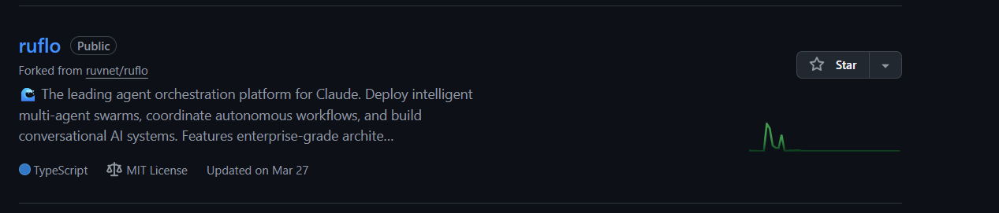

  
    
  
  
  
  
    
  
  
  
    
  
   
  
   
  
   
  

---

## 👨‍💼 Executive Profile

**Software Development Engineer in Test (SDET) & Quality Engineering Specialist** with proven expertise in architecting robust test automation frameworks, validating distributed microservices architectures, and engineering zero-defect CI/CD release pipelines for enterprise-scale platforms.

- **Quality Engineering & Test Automation:** Architect of scalable Page Object Model (POM) and hybrid automation frameworks using Selenium WebDriver and TestNG, reducing regression cycle execution times by over 60%.
- **Microservices & API Contract Testing:** Rigorous validation of distributed RESTful APIs using Postman, REST Assured, and automated JSON schema validation, ensuring 99.9% payload integrity and backward compatibility.
- **Enterprise Software Delivery:** Deep integration of automated testing into continuous integration and continuous deployment (CI/CD) pipelines (Jenkins, GitHub Actions, Docker) with automated gate checks and zero-downtime release targets.
- **Shift-Left QA Culture:** Champion of early bug detection, testability reviews during architecture phases, comprehensive defect lifecycle management in Jira, and rigorous root-cause analysis (RCA).

---

## 🛠️ Enterprise Technology Stack

### 🧪 Quality Engineering & Test Automation Architecture

### ⚙️ Enterprise Backend & Application Development

### 🔄 DevOps, CI/CD & Cloud Infrastructure

### 🗄️ Database Management & Data Validation

### 📊 Enterprise Project & Quality Governance

---

## 📈 Enterprise Quality Engineering Competency Matrix

| Domain | Enterprise Practices & Frameworks | Quality & Business Impact |
|---|---|---|
| **Test Automation Frameworks** | Data-driven & keyword-driven framework design in Java/Selenium; TestNG parallel execution; Page Factory pattern | Reduced regression execution cycles by 60%+ while maximizing test reusability across releases |
| **Microservices & API Validation** | Contract validation, schema enforcement, boundary condition testing, status code compliance with Postman & REST Assured | Ensured zero regression in API payload changes and accelerated backend integration validation |
| **Continuous Testing & CI/CD** | Automated smoke and sanity test triggers on code push; nightly regression test suite scheduling; Dockerized grid runners | Enabled shift-left continuous quality verification, catching 85%+ of critical regressions before staging |
| **Defect Lifecycle Governance** | End-to-end defect tracking in Jira with comprehensive steps-to-reproduce, logs, severity/priority triaging, and RCA | Minimized defect turnaround time and eliminated regression re-open rates |
| **Data Integrity & Backend QA** | Complex SQL validation queries, schema migrations, ACID compliance verification in MySQL & MongoDB | Guaranteed 100% transactional consistency across high-throughput data pipelines |

---

## 🌟 Featured Enterprise Systems & Core Builds

| System | Architecture & Engineering Focus | Repositories |
|---|---|---|
| **CraveBite** | Distributed food-ordering platform engineered with microservices architecture, automated REST API test suites, and high-concurrency order processing. | [Frontend Core](https://github.com/ShreyanshJain105/cravebite-frontend) · [Backend API](https://github.com/ShreyanshJain105/cravebite-backend) |
| **JobTrek** | Enterprise recruitment management portal featuring responsive React UI, role-based authorization, and high-performance Spring Boot services. | [Frontend Portal](https://github.com/ShreyanshJain105/JobTrek-UI) · [Backend Core](https://github.com/ShreyanshJain105/JobTrek-Backend) |

---

## 🔬 Enterprise Open-Source Systems Analysis

Exploratory architectural analysis and contributions to production-grade distributed frameworks and developer infrastructure:

- **[coolify](https://github.com/ShreyanshJain105/coolify)** — Architectural analysis of self-hosted enterprise PaaS and containerized deployment infrastructure.
- **[rea](https://github.com/ShreyanshJain105/rea)** — Deep dive into agent-based reverse engineering, native binary analysis, and automated code decompilation.
- **[ruflo](https://github.com/ShreyanshJain105/ruflo)** — Multi-agent orchestration engine for complex, autonomous enterprise developer workflows.

<b>View Enterprise Architecture Verification Snapshots</b>

 

**rea and coolify systems exploration:**

 

**ruflo orchestration exploration:**

---

## 📊 Continuous Engineering Telemetry

The annual contribution baseline reflects **280+ verified engineering contributions in the last cycle** (historical baseline snapshot captured on 19 November 2026). The telemetry cards at the top are automatically synchronized and updated daily via GitHub Actions.

<b>View Historical Contribution Snapshot</b>

 

---

## 🤝 Executive & Professional Network

Open to discussions regarding **Enterprise Quality Engineering**, **Test Automation Frameworks**, **SDET Initiatives**, and high-impact software engineering opportunities.

> 💬 *"Quality is an engineering discipline, not an afterthought. Scalable automation and resilient testing gates turn velocity into competitive advantage."*

  
  
  

  

---

  Profile telemetry and animated SVG cards are rendered with Python and automated via GitHub Actions scheduled daily at 02:17 UTC.

