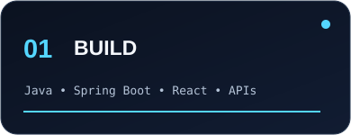
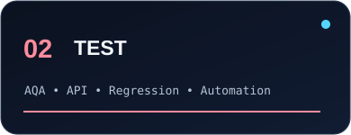
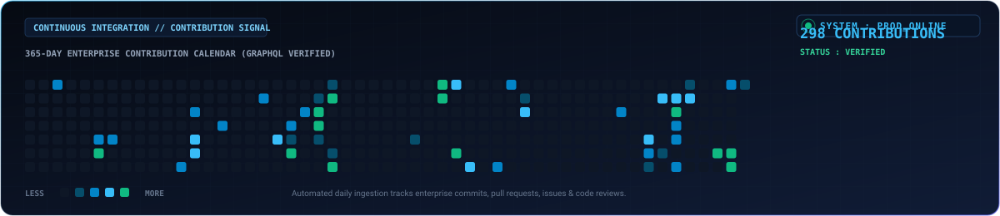
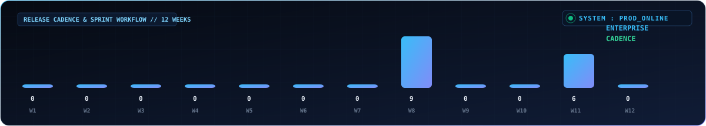
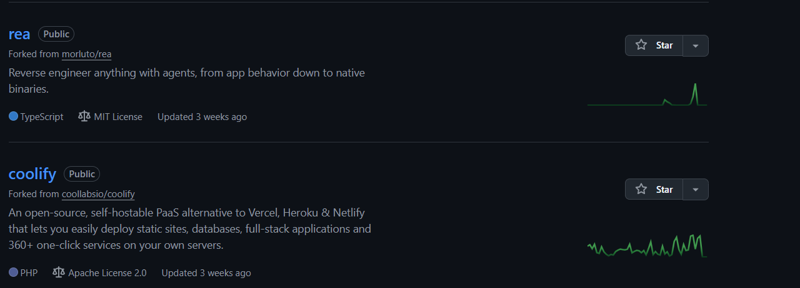
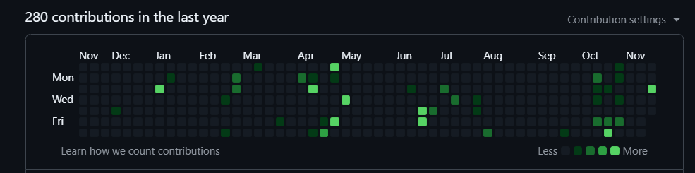

  
   
  <h1 align="center">Hi, I'm Shreyansh Jain 👋</h1>
  

    <em>Quality Assurance Engineer · Test Automation · SDET · Full-Stack Testing Specialist</em>
  

  

    
    
    
    
  

   
  
   
  
  
  
    
  
   
  
   
  
   
  

---

## 👨‍💼 Professional Summary

**Quality Assurance Engineer** with hands-on experience in **manual testing, API testing, and test automation** for scalable web applications. Proven expertise in designing comprehensive test strategies, executing functional and regression testing, and managing the complete defect lifecycle using industry-standard tools.

I combine strong **technical development skills** with **QA engineering principles** to bridge the gap between development and quality assurance, ensuring robust, production-ready software delivery in **Agile/Scrum** environments.

- **Quality engineering:** Functional, regression, API, integration, and end-to-end testing.
- **Automation & tooling:** Java, JavaScript, Postman, Selenium, Jira, GitHub, Jenkins, and Docker.
- **Software development:** React.js, Spring Boot, REST APIs, SQL, and MongoDB.
- **AI exploration:** AI voice agents, conversational workflows, LLM integrations, and multi-agent systems.

---

## 🚀 What I'm Working On

- 🔍 **Specializing** in QA Engineering, Test Automation, and API Testing
- 🌱 **Deepening expertise** in Selenium, TestNG, and advanced test automation frameworks
- 🤝 **Open to collaboration** on testing frameworks, automation projects, and quality engineering initiatives
- 📐 **Exploring** CI/CD integration, performance testing, and modern SDET practices

---

## 🛠️ Technical Arsenal

### 🧪 QA & Testing Core

### 🤖 Test Automation & Tools

### 📊 Project Management & Bug Tracking

### 💻 Development Skills (SDET Edge)

### 🗄️ Databases

### ☁️ Cloud & DevOps

---

## 📈 Core QA Competencies

| **Testing Domain** | **Expertise** |
|---|---|
| **Test Design & Execution** | Test Case Design, Test Plan Creation, Functional Testing, UI Testing, Smoke & Sanity Testing |
| **API & Integration Testing** | REST API Validation (Postman), JSON/XML Parsing, Status Code Verification, Data Integrity Checks |
| **Regression & Quality Control** | Regression Test Suites, Cross-Browser Testing, Root Cause Analysis, Impact Assessment |
| **Defect Management** | Jira Workflow, Bug Lifecycle, Defect Reporting, Severity/Priority Classification, Retesting & Verification |
| **Automation Fundamentals** | Selenium WebDriver (Basic), Test Automation Strategy, n8n/Zapier Workflow Automation |
| **Methodologies** | SDLC, STLC, Agile/Scrum, Continuous Testing, Cross-Functional Collaboration |

---

## 🌟 Featured Projects

| Project | Focus | Repositories |
|---|---|---|
| **CraveBite** | Food-ordering platform | [Frontend](https://github.com/ShreyanshJain105/cravebite-frontend) · [Backend](https://github.com/ShreyanshJain105/cravebite-backend) |
| **JobTrek** | Job portal with React UI and Spring Boot backend | [UI](https://github.com/ShreyanshJain105/JobTrek-UI) · [Backend](https://github.com/ShreyanshJain105/JobTrek-Backend) |

---

## 🔬 Open-Source Repositories

These are public forks visible on my profile. They are shown as open-source projects I have explored, not as software I originally authored.

- [rea](https://github.com/ShreyanshJain105/rea) — agent-based reverse engineering, from app behavior to native binaries.
- [coolify](https://github.com/ShreyanshJain105/coolify) — self-hostable PaaS for deploying applications and services.
- [ruflo](https://github.com/ShreyanshJain105/ruflo) — Claude-focused multi-agent orchestration and autonomous workflows.

Repository activity screenshots supplied for this profile

**rea and coolify**

**ruflo**

---

## 📊 Contribution Activity

The supplied GitHub contribution graph shows **280 contributions in the last year** (snapshot captured on 19 November 2026). The live cards are refreshed daily by GitHub Actions. For exact daily contribution counts, configure the `GH_TOKEN` secret as described in `SETUP.md`; without it, public events are only an approximation and are clearly labelled.

---

## 🤝 Let's Connect

I'm actively seeking **QA Engineer**, **SDET**, and **Test Automation** roles where I can leverage my technical expertise and testing acumen to deliver high-quality software products.

Open to discussing **quality assurance strategies**, **test automation**, **API testing**, or exciting **career opportunities** in product-driven organizations.

> 💬 *"Quality is not an act, it is a habit. I ensure every release is production-ready through meticulous testing and attention to detail."*

  
  
  

---

  

  

---

Profile cards are generated with Python and SVG. GitHub Actions refreshes repository, activity, contribution, and daily activity cards once per day. The daily workflow commits changed assets back to this profile repository.
